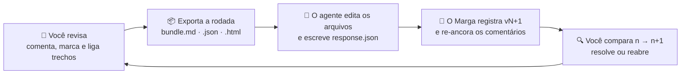

<div align="center">

# 🖍️ marga

**Revise documentos como quem revisa um pull request e entregue as correções a um agente de IA.**

Marque trechos no fonte LaTeX ou direto no PDF, comente, ligue trechos entre arquivos e exporte a rodada num pacote que o agente entende.<br>
O agente edita os arquivos; o Marga registra a nova versão, reposiciona os comentários e mostra o diff.

[](pyproject.toml)
[](https://streamlit.io)
[](https://docs.astral.sh/uv/)
[](https://tug.org/texlive/)


[Começo rápido](#-começo-rápido) · [Como funciona](#-como-funciona) · [Pacote para o agente](#-o-pacote-para-o-agente) · [Desenvolvimento](#-desenvolvimento) · [Guia para agentes de IA](AGENTS.md)

</div>

---

## ✨ O que ele faz

Pedir correções a um agente pelo chat ("no segundo parágrafo da introdução, troque…") é impreciso e se perde de uma rodada para a outra. O Marga transforma a revisão num pacote estruturado, com citação exata, linha e coluna de cada pedido, e acompanha o que mudou depois que o agente mexeu nos arquivos.

| | |
|---|---|
| 🎯 **Comentários ancorados** | Selecione no fonte (precisão de caractere) ou no PDF (clique e retângulo, via SyncTeX). Cada comentário guarda arquivo, linhas, colunas e a citação exata. |
| 🪟 **Duas colunas** | Fonte × PDF (como no Overleaf), documento A × B ou v3 × v4, lado a lado. |
| 🔗 **Rastreio entre arquivos** | Ligue trechos (consistente, propagar, mover, contradiz…) e veja o grafo dos links. |
| 📦 **Rodadas para o agente** | Um pacote em Markdown, JSON e HTML, mais um prompt curto para colar no Claude Code (ou em outro agente com acesso à pasta). |
| 🔄 **Versões e re-ancoragem** | Snapshots imutáveis por sha256. Na versão nova, cada comentário fica *inalterado*, *alterado*, *movido* ou *órfão*. |
| ⚡ **Compilação paralela** | `latexmk` compila os documentos visíveis ao mesmo tempo; um erro de compilação vira comentário com um clique. |
| 📕 **PDFs avulsos** | PDFs sem fonte também são revisáveis, a partir do texto extraído de cada página. |
| 📦 **Projetos do Overleaf** | O `.zip` baixado do Overleaf vira um documento LaTeX completo: vários `.tex`, figuras e bibliografia. |
| 🧭 **Seções** | Em PDFs grandes, uma lista de seções leva direto a cada capítulo e filtra o texto. Ela vem do fonte LaTeX, dos marcadores do PDF ou de títulos detectados pela tipografia. |
| 🔒 **Local e não destrutivo** | Quem edita é o agente. O Marga só escreve em `.marga/` (e em `uploads/`, quando você envia um arquivo). |

## 🚀 Começo rápido

**Requisitos**

| Ferramenta | Para quê | Obrigatório? |
|---|---|---|
| [uv](https://docs.astral.sh/uv/) | Instala as dependências e roda o app | Sim |
| Python 3.11+ | Runtime | Sim (se faltar, o uv baixa um) |
| TeX Live: `latexmk`, `synctex` e `pdflatex`/`xelatex`/`lualatex` | Compilar LaTeX e ligar o clique no PDF à linha do fonte | Não. Sem ele, o resto funciona e a seleção no PDF usa busca aproximada de texto |

<details>
<summary>Como instalar o uv e o TeX Live</summary>

```bash
curl -LsSf https://astral.sh/uv/install.sh | sh   # ou: brew install uv
```

```bash
brew install texlive   # macOS
```

```bash
sudo apt install latexmk texlive-latex-extra texlive-lang-portuguese   # Debian/Ubuntu
```

O exemplo usa `babel` com `brazilian`, por isso o pacote de idioma português.

</details>

**Instale e abra o exemplo**

```bash
git clone https://github.com/mgteus/marga.git
cd marga
uv sync
uv run marga examples/demo
```

O app abre em <http://localhost:8501>. Na barra lateral, vá em **➕ Adicionar documento → Pasta**, escolha `artigo/` e clique em **Adicionar artigo**: o fonte aparece ao lado do PDF, já compilado. Clique num número de linha, escreva um pedido e salve: esse é o seu primeiro comentário.

> [!TIP]
> Na primeira execução, o Streamlit pode pedir um e-mail no terminal. É opcional: aperte Enter.

**Abrindo outras pastas**

```text
marga [pasta] [opções do Streamlit]
```

| Comando | O que faz |
|---|---|
| `uv run marga` | Abre a pasta atual como workspace |
| `uv run marga ~/papers/tese` | Abre outra pasta (cria `~/papers/tese/.marga/` na primeira vez) |
| `uv run marga ~/papers/tese --server.port 8600` | Usa outra porta (as opções do Streamlit vão depois da pasta) |
| `uv run marga ~/papers/tese --server.headless true` | Não abre o navegador (útil em servidores e para agentes) |
| `uv run --project ~/marga marga .` | Roda de qualquer lugar, usando o ambiente do repositório |

Dá para trocar de workspace depois, pela barra lateral.

> [!NOTE]
> Vai usar um agente de IA para mexer *neste repositório*? O [AGENTS.md](AGENTS.md) explica a instalação, o primeiro servidor passo a passo, a arquitetura e as convenções.

## 🔁 Como funciona



1. **Adicione documentos** na barra lateral, em **➕ Adicionar documento**. Cada documento ganha uma letra (A, B, C…) e a v1, e o nome digitado vira o nome do documento.

   | Origem | O que aceita |
   |---|---|
   | **Enviar** | Um arquivo do computador: `.zip` do Overleaf, `.pdf`, `.tex`, `.md` ou `.txt` |
   | **Pasta** | O que já está na pasta: pastas LaTeX (o `.tex` com `\documentclass`), PDFs avulsos e textos (`.md`, `.txt`, `.rst`) |
   | **Disco** | O caminho de um arquivo (ex.: `~/Downloads/projeto.zip`), sem passar pelo navegador. Melhor para arquivos grandes |
2. **Revise em duas colunas.** Cada coluna mostra um documento, uma versão e um modo (Fonte ou PDF). O PDF compila sozinho na primeira vez; **▶ Compilar visíveis** recompila os documentos LaTeX das duas colunas em paralelo.
   - **§ Seções:** no modo PDF, a lista ao lado do número da página acompanha a página atual e salta para qualquer capítulo ou seção. Digite parte do título para filtrar.
   - No texto de um PDF avulso, a mesma lista filtra o trecho mostrado. Acima de 120 páginas, o texto aparece por seção ou em blocos de 20 páginas.
   - No fonte LaTeX, **§ Ir para seção** abre o arquivo na linha do título e leva junto o PDF da outra coluna.
   - As seções vêm do fonte LaTeX (posicionado pelo SyncTeX), dos marcadores do PDF ou, em PDFs sem marcadores, de títulos detectados pela tipografia.
3. **Selecione e comente.**
   - Fonte: arraste para selecionar, ou clique/arraste nos números de linha (shift estende).
   - PDF: o clique leva à linha do fonte; arrastar um retângulo seleciona o trecho (SyncTeX + texto do PDF).
   - Se quiser, sugira o texto substituto: ele vira um diff no pacote, como as *suggestions* do GitHub.
4. **Ligue trechos entre arquivos** em **↔ Linkar trechos**: origem → relação → destino. Uma seleção usada num link vira uma marca (`mN`), e a aba *Links* mostra o grafo.
5. **Exporte a rodada** na aba *Rodadas*. O Marga grava `.marga/rounds/NNN/` e mostra um prompt curto para colar no agente.
6. **O agente edita os arquivos** no lugar e escreve `.marga/rounds/NNN/response.json`, com uma nota por comentário.
7. **Registre a nova versão.** A barra lateral avisa quando os arquivos mudam no disco (**Registrar vN+1**). Os comentários abertos são reposicionados e as notas do agente entram no histórico.
8. **Compare** na aba *Comparar versões*: antes × depois de cada comentário, nota do agente e diff por arquivo. Resolva, descarte ou reabra com uma nova instrução, e exporte a próxima rodada.

<details>
<summary>📦 Projetos do Overleaf (.zip)</summary>

1. No Overleaf, use **Menu → Download → Source** para baixar um `.zip` com os `.tex`, a bibliografia e as figuras.
2. No Marga, envie o `.zip` em **Enviar** ou cole o caminho dele em **Disco**. O projeto é extraído em `uploads/<nome do zip>/`, sem o lixo do macOS, e vira um documento LaTeX. O principal é o `main.tex` (ou outro `.tex` com `\documentclass`).
3. O motor padrão é o pdflatex. O Marga usa xelatex quando o projeto carrega `fontspec`/`polyglossia` ou tem `% !TEX program`. Se no Overleaf o projeto usa outro compilador, troque o **Motor** em **⚙️ Ajustes de documento**.
4. Se faltar um pacote no TeX Live local, o log mostra o arquivo e o comando para descobrir qual pacote instalar (`tlmgr search --global --file /arquivo.sty`). Projetos com biblatex precisam do `biber`.

A primeira compilação de um projeto com muitas figuras leva alguns minutos. Uma dissertação com cerca de 350 MB de imagens levou cerca de 100 s, e o limite é de 10 minutos. O `marga` aceita envios de até 2 GB e as versões antigas reaproveitam as figuras por hard link, sem copiá-las.

</details>

<details>
<summary>Tipos de comentário e relações de link</summary>

| Tipo | O que o agente deve fazer |
|---|---|
| `corrigir`, `reescrever`, `remover`, `inserir` | Editar o trecho |
| `pergunta` | Responder na nota, sem editar |
| `nao_alterar` | Não mexer no trecho |
| `nota` | Usar como contexto |
| `erro_compilacao` | Corrigir para o documento compilar |
| `marca` (`mN`) | Só marca um trecho, em geral para servir de ponta de um link |

| Relação | Significado |
|---|---|
| `consistente` | No fim, os dois trechos dizem a mesma coisa |
| `propagar` | Aplicar no destino a mesma mudança feita na origem |
| `origem` | O destino deriva da origem; revisar se a origem mudar |
| `mover` | Levar o conteúdo da origem para o destino |
| `contradiz` | Resolver a contradição |
| `ver_tambem` | Só contexto |

</details>

## 📦 O pacote para o agente

Cada rodada fica em `.marga/rounds/NNN/`, e a mais recente também em `.marga/rounds/latest.{md,json}`.

| Arquivo | Para quem | Conteúdo |
|---|---|---|
| `bundle.md` | Agente | O prompt: regras, comentários por arquivo com trecho numerado e citação exata, sugestões como diff, links (com diagrama mermaid) e o formato da resposta |
| `bundle.json` | Agente / scripts | Os mesmos dados estruturados (schema `marga.bundle/v1`), incluindo o diff desde a versão anterior |
| `bundle.html` | Você | Relatório para leitura humana, autocontido |
| `response.json` | Escrito pelo agente | Uma nota por comentário (schema `marga.response/v1`) |

O prompt que o Marga mostra é parecido com:

```text
Estou revisando os documentos do workspace /caminho/da/pasta com o Marga. Leia .marga/rounds/001/bundle.md
e aplique os comentários editando os arquivos no lugar, seguindo as regras do pacote. Ao terminar, escreva
.marga/rounds/001/response.json no formato descrito na seção Resposta do pacote.
```

E a resposta do agente:

```json
{
  "schema": "marga.response/v1",
  "round": 1,
  "resumo": "o que mudou, em poucas linhas",
  "comments": {
    "c1": {"status": "feito", "nota": "troquei 2019 por 2021"},
    "c2": {"status": "resposta", "nota": "resposta à pergunta"},
    "c3": {"status": "feito", "substituicao": "texto corrigido (para PDF avulso)"}
  }
}
```

Status aceitos: `feito`, `parcial`, `nao_feito` e `resposta`.

<details>
<summary>📁 O que fica em <code>.marga/</code></summary>

```text
.marga/
├── marga.json                   documentos, contadores e ajustes
├── objects/                     conteúdo de cada versão, endereçado por sha256
├── docs/A/versions.json         versões de cada documento
├── annotations.json             comentários (cN) e marcas (mN)
├── links.json                   links (LN)
├── rounds/NNN/                  round.json, bundle.{md,json,html} e response.json
├── rounds/latest.{md,json}      a rodada mais recente
├── AGENT.md                     guia fixo para o agente que aplica as rodadas
├── build/A/vN/                  saídas do latexmk (out/), snapshot da versão (src/), result.json e outline.json
└── cache/                       texto (pdftext/) e seções (outline/) extraídos dos PDFs avulsos
```

Apague `.marga/` para recomeçar do zero. Seus arquivos continuam onde estão.

</details>

## 🧪 Desenvolvimento

```bash
uv sync             # dependências do uv.lock, incluindo o grupo dev (pytest)
uv run pytest       # os testes de LaTeX são pulados sem latexmk/synctex
```

Dois testes opcionais usam seus próprios arquivos e só rodam quando a variável aponta para eles. O primeiro importa e compila um projeto do Overleaf e confere as seções:

```bash
MARGA_ZIP="$HOME/Downloads/projeto.zip" uv run pytest tests/test_zip_import.py -k real -s
```

O segundo mostra os títulos detectados num PDF:

```bash
MARGA_PDF="$HOME/Downloads/documento.pdf" uv run pytest tests/test_outline.py -k real -s
```

| Pasta | O que tem |
|---|---|
| `marga/core/` | Lógica sem Streamlit: workspace, versões, âncoras, diff, LaTeX, SyncTeX, PDF e exportação |
| `marga/ui/` | App Streamlit: barra lateral, abas e os dois componentes visuais |
| `marga/ui/frontend/` | JS e CSS puros dos componentes de fonte e de PDF (API de componentes v2 do Streamlit, sem build). Depois de editar, reinicie o servidor |
| `tests/` | pytest: núcleo, integração com LaTeX/SyncTeX e smoke test do app |
| `examples/demo/` | Workspace de exemplo: artigo multi-arquivo, suplemento, parecer em PDF e notas |

O design completo está em [`docs/superpowers/specs/2026-11-22-marga-design.md`](docs/superpowers/specs/2026-11-22-marga-design.md), e as convenções para quem contribui (pessoas ou agentes) estão no [AGENTS.md](AGENTS.md).

## 🚧 Limitações conhecidas

- O PDF é mostrado uma página por vez. Navega-se pelas setas, pelo número ou pela lista de seções.
- A detecção de títulos em PDFs sem marcadores é uma heurística. Ela funciona bem com títulos numerados em negrito ou maiores que o texto (o padrão do LaTeX), mas pode errar em layouts incomuns.
- Só se comenta na versão mais recente, e só quando o disco bate com ela (registre a nova versão antes).
- Versões antigas compilam com as figuras atuais da pasta: só arquivos de texto (`.tex`, `.bib`, `.sty`, `.cls`, `.bst`, `.md`, `.markdown`, `.txt`, `.rst`) são versionados.
- Não há editor de texto no app nem chamada direta a uma API de LLM: o pacote é feito para um agente com acesso à pasta.
- Testado no macOS. Linux deve funcionar; no Windows, prefira o WSL (o código usa chamadas POSIX, como `os.killpg`).
