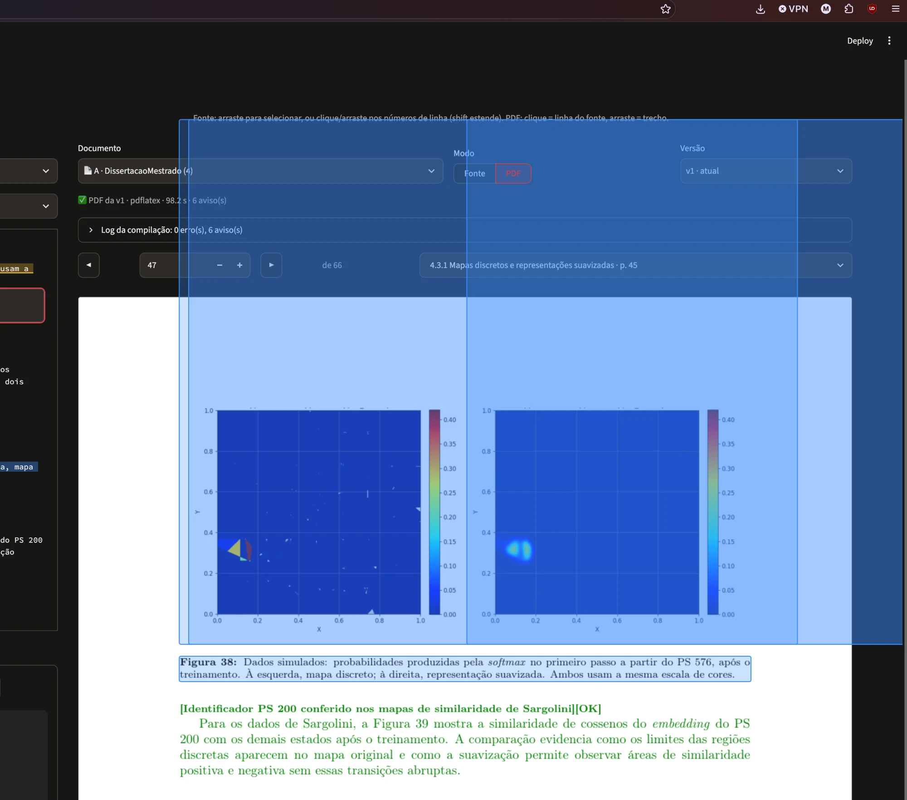

# Bugs encontrados no uso da v0.1

Lista de trabalho da branch `fix/bugs-v0.1`, criada em 2026-11-23 a partir da `dev` (`12c5abd`). Os itens vieram do uso real do app e foram corrigidos nesta branch; cada um termina com a correção feita. Os prints ficam em [`img/`](img/).

| # | Bug | Onde | Status |
|---|---|---|---|
| 1 | Selecionar uma figura no PDF marca uma região que sai da página | PDF · seleção | corrigido |
| 2 | O prompt não diz onde ficam os arquivos que o agente deve editar | Rodadas · prompt | corrigido |
| 3 | Registrar um `.zip` novo como a próxima versão de um documento | Adicionar documento | corrigido |
| 4 | Num workspace que é repositório git, `.marga/` e `uploads/` aparecem como não rastreados | Workspace | corrigido |
| 5 | Escolher a pasta do workspace pelo Finder, sem digitar o caminho | Barra lateral · workspace | corrigido |

## 1 · Selecionar uma figura no PDF marca uma região que sai da página

- **Onde:** documento `A · DissertacaoMestrado (4)`, o LaTeX importado do `.zip` do Overleaf. Modo PDF, v1, página 47 de 66, seção 4.3.1. A Figura 38 traz dois mapas de calor lado a lado e uma legenda de duas linhas.
- **O que foi feito:** arrastar no PDF para selecionar só a área da figura.
- **O que aconteceu:**
  - Os retângulos azuis da marcação saem da página. Para cima, vão até o topo da coluna e cobrem o seletor de documento, o modo, a versão, o status da compilação e a navegação de páginas. Para a direita, passam da borda da página e chegam à borda da janela.
  - São vários retângulos sobrepostos, todos com a mesma altura. Um começa na margem esquerda do texto e os outros ficam sobre cada um dos mapas.
  - A legenda da figura também ficou contornada, embora a seleção fosse só a figura.
- **Esperado:** a marcação fica dentro da página, recortada aos limites da imagem do PDF, e cobre só a região selecionada.
- **Pistas, a confirmar na hora de corrigir:**
  - O topo dos retângulos coincide com o topo da coluna. As caixas devem começar acima da página, e nada as recorta.
  - Se a figura for uma imagem (PNG), não há palavras dentro dela. A seleção deve ter recorrido ao SyncTeX, que devolve as caixas do float ou do `\includegraphics`. Essas caixas podem ser bem maiores que a figura, o que explicaria a legenda marcada.
  - Arquivos: `marga/ui/frontend/pdf_view.js`, que desenha as marcas sobre a página. As caixas vêm de `marga/ui/review.py`, `marga/core/synctex.py` e `marga/core/pdf.py`.
- **Para reproduzir:** num documento LaTeX com uma figura em `\begin{figure}[H]` e `\includegraphics`, abrir o modo PDF na página da figura e arrastar só sobre ela.
- **Causa:** duas falhas do SyncTeX com figuras escaladas (`width=0.48\linewidth`).
  - Num ponto dentro da imagem, a busca inversa devolve a linha 0, e a seleção caía na linha 1 do arquivo.
  - Para a linha do `\includegraphics`, a busca direta devolve a figura no tamanho natural. Na p. 47, a caixa ia de y = −137 até x = 767, numa página de 595 × 842 pt. Nada recortava as marcas.
- **Correção:**
  - A linha 0 vira a linha do `\includegraphics` da figura sob o ponto (`synctex.figure_at`).
  - As caixas das imagens viram a área real de cada imagem na página (`synctex.fit_images`, com `pdf.image_rects`).
  - Toda marca é recortada à página no servidor (`pdf.clip_rect`) e de novo no navegador. Arrastar para fora da página para na borda.
  - Na Figura 38, cada mapa agora seleciona o próprio `\includegraphics` (linhas 159 e 160), e a marca cobre só a imagem. Testes em `tests/test_figures.py`.
  - Limite que sobra: uma figura vetorial (PDF incluído) não aparece como imagem na página, então a marca dela continua a caixa do SyncTeX, mas recortada à página.

## 2 · O prompt não diz onde ficam os arquivos que o agente deve editar

- **Onde:** rodada 1 do workspace `navitrans`, documento `A · DissertacaoMestrado (4)`, que veio de um `.zip` do Overleaf.
- **O que aconteceu:** o agente não editou a cópia que o Marga acompanha, `uploads/DissertacaoMestrado (4)/`. Pelo resumo da resposta, ele aplicou a revisão direto no Overleaf, e o projeto foi baixado de lá como `DissertacaoMestrado (6).zip`. A resposta foi importada, mas a A continua na v1. Como nada mudou no disco, não há v2 para comparar e os comentários não foram re-ancorados.
- **Causa provável:** o prompt diz "aplique os comentários editando os arquivos no lugar", sem dizer que lugar é esse. Para quem conhece o projeto no Overleaf, o lugar natural é o Overleaf.
- **Esperado:** o prompt e o pacote dizem onde editar: a pasta de cada documento, com o caminho absoluto. Dizem também que o Marga só enxerga mudanças nessa pasta e que o agente não deve gerar `.zip` nem editar outra cópia do projeto.
- **Onde mexer:** `agent_prompt`, `RULES` e `AGENT_GUIDE` em `marga/core/export.py`, a lista de documentos do `bundle.md`, `tests/test_export.py` e o README.
- **Correção:**
  - O prompt lista o caminho completo de cada documento editável, avisa que o Marga só enxerga mudanças ali e pede para não gerar `.zip` nem editar outra cópia.
  - O `bundle.md` e o `bundle.html` abrem com a seção *Onde editar*, antes das regras.
  - O `bundle.json` ganhou a chave opcional `abs_root` em cada documento; o schema continua `marga.bundle/v1`.
  - A primeira regra e o `.marga/AGENT.md` dizem o mesmo.

## 3 · Registrar um `.zip` novo como a próxima versão de um documento

- **Onde:** **➕ Adicionar documento**, workspace `navitrans`.
- **O que aconteceu:** com o `.zip` pós-ajuste em mãos, a ideia era subi-lo como a v2 da A. Hoje, **Adicionar documento** sempre cria um documento novo: o `(6).zip` virou o documento B, sem ligação com a A. Sem essa ligação, os comentários da A não são re-ancorados e não há comparação v1 → v2.
- **Por que importa:** em projetos do Overleaf, o Overleaf é a fonte da verdade. Um fluxo natural é comentar no Marga, aplicar as mudanças no Overleaf (o agente ou a própria pessoa) e trazer o `.zip` novo para o Marga como vN+1.
- **Proposta:** ao enviar um `.zip`, oferecer a opção "nova versão de um documento existente". O Marga extrai o `.zip` sobre a própria cópia em `uploads/<documento>/` e registra a vN+1 ligada à rodada pendente, como já faz quando o agente edita o disco.
- **Decidido:**
  - O Marga passa a sobrescrever as próprias cópias em `uploads/`, e só elas. Documentos com arquivos fora de `uploads/` recusam o `.zip`.
  - Textos versionados que não vêm no `.zip` saem da cópia (a versão anterior continua guardada). Figuras e outros arquivos que sumiram ficam, para as versões antigas continuarem compilando.
  - Vale para documentos LaTeX e de texto que são pastas em `uploads/`, venham de `.zip` ou de um `.tex` enviado.
- **Correção:**
  - Em **Enviar** ou **Disco**, um `.zip` mostra **Adicionar como** (documento novo ou **Nova versão de A**) e o botão **Registrar como v2 de A**.
  - Por trás, `actions.update_from_zip` extrai o `.zip` numa pasta temporária, compara com a cópia, aplica e registra a versão nova, ligada à rodada pendente.
  - O `.zip` é recusado se for de outro projeto (sem o arquivo principal), se a cópia tiver mudanças não registradas ou se for igual à versão atual.
  - Testes em `tests/test_zip_import.py` e `tests/test_app.py`.

## 4 · Num workspace que é repositório git, `.marga/` e `uploads/` aparecem como não rastreados

- **Onde:** o workspace `navitrans` também é um repositório git, e lá o `git status` mostra `.marga/` e `uploads/` como não rastreados. Observado ao investigar o item 3, não no uso.
- **Risco:** um `git add .` no `navitrans` levaria para o repositório o estado do Marga e as cópias da dissertação, com todas as figuras.
- **Proposta:** ao abrir o workspace, o Marga cria `.marga/.gitignore` com `*`, como o `uv` faz no `.venv`. Para `uploads/`, decidir se faz o mesmo ou só avisa na barra lateral.
- **Correção:**
  - Ao abrir o workspace, o Marga cria `.marga/.gitignore` com `*`.
  - Também cria `uploads/.gitignore`, ao abrir ou no primeiro envio. Ele só é criado quando não existe: para versionar as cópias, basta esvaziá-lo.
  - Workspaces antigos, como o `navitrans`, ganham os dois arquivos na próxima vez que forem abertos. Um teste roda `git status` de verdade e só vê os arquivos do próprio workspace.

## 5 · Escolher a pasta do workspace pelo Finder, sem digitar o caminho

- **Pedido:** hoje, para trocar de workspace, é preciso digitar o caminho completo em **Workspace (pasta)**, na barra lateral. Digitar o caminho toda vez cansa.
- **Proposta:** um botão ao lado do campo, como **📁 Escolher pasta…**, que abre o seletor de pastas do Finder e preenche o campo com a pasta escolhida.
- **Pistas para a implementação:**
  - O navegador não entrega o caminho completo de uma pasta escolhida ou arrastada, então quem abre o seletor é o servidor. Como o Marga roda na própria máquina, no macOS basta `osascript -e 'POSIX path of (choose folder)'`. Se a pessoa cancelar, o comando falha com o erro -128, e o app deve só seguir sem mensagem.
  - O `tkinter` não é uma boa opção: o Streamlit roda o script fora da thread principal, e o Tk no macOS só funciona na thread principal.
  - No Linux, dá para usar `zenity --file-selection --directory` ou `kdialog` quando existirem. Sem nenhum deles, o botão não aparece.
  - A janela abre no computador onde o servidor roda. Se o app for aberto de outra máquina, a pessoa não vê o seletor.
  - Para preencher o campo, use `state.request`, porque o valor de um widget não pode mudar depois de desenhado. O campo fica em `marga/ui/sidebar.py`.
  - Complemento barato: uma lista dos workspaces usados recentemente, para trocar sem digitar nem abrir o Finder.
- **Correção:**
  - Abaixo do campo há o botão **📁 Finder** (ou **📁 Escolher pasta…**, sem recentes), que abre o seletor do sistema já na pasta de cima do workspace atual.
  - Ao lado fica **🕘 Recentes**, com os últimos oito workspaces que ainda existem.
  - A lista mora fora dos workspaces, em `~/Library/Application Support/marga/recentes.json` no macOS. Um arquivo corrompido não é sobrescrito.
  - Código em `marga/core/folders.py`, testes em `tests/test_folders.py` e `tests/test_app.py`.
